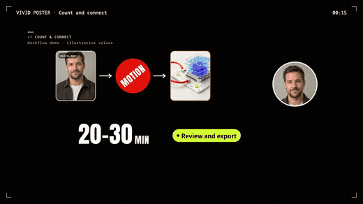
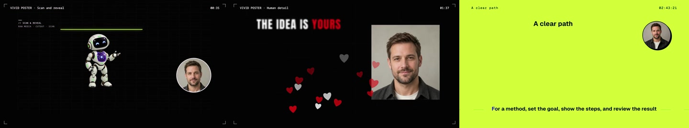

# Vibrant Poster · Narrated Explainer

Support narration with high-contrast posters, bold type, lists and graphic relationships in a dedicated landscape layout.

**16:9 · 1920 × 1080 · 60 fps · v2.7.10** · [@adunext](https://motiongit.com/@adunext) · [简体中文](README.zh-CN.md)

**[Template details, full .motion & demo](https://motiongit.com/@adunext/vibrant-poster)**
https://motiongit.com/@adunext/vibrant-poster

Download available; current terms are listed with the package.

## Demo

[Full demo](https://motiongit.com/@adunext/vibrant-poster) · [Play video](https://media.openaicut.com/previews/623/draft-en-e9dd279eebe9.mp4)

## How it works

- Declared runtime profile: adu-authored-unit/1.
- Editable inputs are mapped through the template parameter schema and preset to its existing animation project.
- The template uses authored animation units selected for the meaning and quantity of the current content.
- The declared duration policy follows the current voiceover; the package plan determines final timing rather than the demo length.

Demo duration: **194s**. The documented output is 1920 × 1080, 60 fps. The public demo is 194 seconds. Use the actual package parameter bounds; extra materials do not automatically create extra scenes. Faking real data or creator identities Inventing semantic quantities to force a scene

## Inputs and materials

- **Optional:** Your current talking-head video with its original audio for the native presenter workflow.
- **Required:** A transcript or SRT matching the current narration/video.
- **Optional:** The topic, key points and output preferences already available in the conversation.

Useful for: User narration with bold typographic emphasis · Explicit media, checklists and illustrative relationships

## Runtime requirements

- The package declares a Python and Node.js host. Check its dependency lock for supported versions and any additional rendering tools.
- Use the package dependency lock and setup/check instructions. Check existing tools first, install only missing requirements and verify a preview.

## Use the template

1. Obtain the current .motion package from the [template page](https://motiongit.com/@adunext/vibrant-poster).
2. Extract or load it as documented, then read the included README and referenced production guide.
3. Use your own content and materials, reuse the working environment, and follow the package entry point to inspect a real preview.

You can give an assistant the repository URL and this request:

> https://github.com/motiontemplates/762139
>
> Use this .motion template with my content. Obtain the package from https://motiongit.com/@adunext/vibrant-poster, extract or load it as documented, read the included README and referenced guide, reuse my working environment, and follow the package workflow to show an actual preview.

## .motion format

MotionGit .motion is a reusable video-template format that organizes the animation project, parameters, assets, dependencies and production guide. Its runtime uses new content to produce a finished video. [Format documentation](https://motiongit.com/spec)

[Versions, license & full download](https://motiongit.com/@adunext/vibrant-poster) · [Production reference](ASSISTANT.md)
